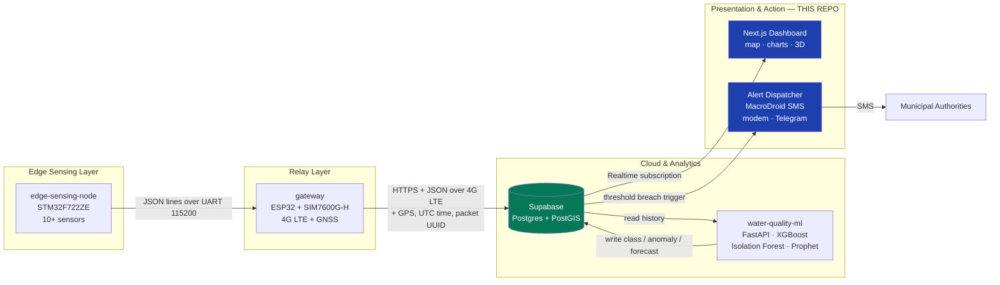
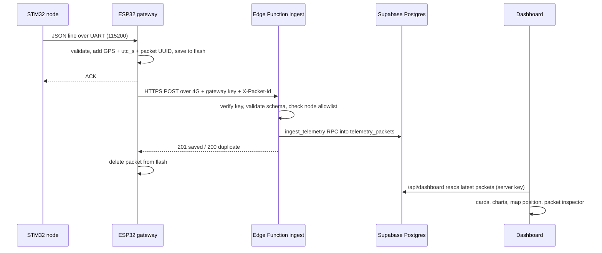

# wqm-web-dashboard

**Real-time web dashboard & backend for the WQM River Water Quality Monitor** — the presentation and action layer of the [WQM-Project](https://github.com/WQM-Project) ecosystem.

**Live:** <https://wqm-web-dashboard.vercel.app>

This repo owns everything a human sees or is alerted by. It ingests telemetry relayed from the [`gateway`](https://github.com/WQM-Project/gateway), persists it, renders it as live geospatial and time-series visualisations, surfaces predictions from [`water-quality-ml`](https://github.com/WQM-Project/water-quality-ml), and dispatches threshold-breach alerts to local authorities.

> [!NOTE]
> **Current status (November 2026):** the boat-to-dashboard chain works end to end. The STM32 sensor node sends readings over UART to the ESP32 + SIM7600G-H gateway, which adds the GPS position, a UTC timestamp and a packet UUID, stores each packet in flash and uploads it over 4G (HTTPS) to the Supabase `ingest` Edge Function. `/dashboard` shows measurement cards, selectable trends, dissolved-solids trend, packet activity, the boat's live GPS position on the map, packet inspection and CSV export. ML forecasts, alerts and admin authentication are the next workstreams.

### Run the dashboard

Start with `npm run dev`, then open `http://localhost:3000/dashboard`.
The landing page also includes an **Open monitoring dashboard** link.
The moon/sun button in the dashboard header switches between light and dark
palettes. The choice is saved in browser storage and a dashboard-scoped cookie,
so page reloads render the saved palette. Charts, packet dialogs and map controls
follow the palette; OpenStreetMap raster tiles use a CSS filter in dark mode.

Choose a 1/6/24-hour window, select any of the 12 chart parameters, inspect a
packet or export the selected readings. **Gateway history** shows the packets
uploaded by the boat. Windows end at the latest stored packet, not the current
clock, and Refresh fetches the newest stored data. The server loads at most 500
packets per request and displays a notice if that limit is reached. The
read-only `/api/dashboard` route reads with a server key; credentials are never
passed to the browser.

The packet inspector shows the full stored payload, a short form of the
gateway-generated packet **UUID** (with a copy button for the full value) and
when the server received the packet.

### Gateway ingestion

The gateway (`ESP32 + SIM7600G-H`, see the
[gateway repository](https://github.com/WQM-Project/gateway)) posts each packet
to the Supabase Edge Function `supabase/functions/ingest`, generated from
`lib/server/ingest.ts` (`npm run edge:prepare`). Every request must carry:

- `Authorization: Bearer <GATEWAY_INGEST_KEY>`
- `Content-Type: application/json`
- `X-Packet-Id: <uuid>`, generated once per packet by the gateway

The handler validates every field against `packetSchema`, accepts only node IDs
listed in `GATEWAY_ALLOWED_NODE_IDS`, and stores the packet in
`public.telemetry_packets` through the `ingest_telemetry` RPC. A retry with the
same packet ID and identical data returns `200` with `duplicate: true`, so
cellular retries never create duplicate readings; the same ID with different
data returns `409`. Deploy after changing the schema:

```bash
npm run edge:prepare
npx supabase@latest functions deploy ingest --project-ref scvcufiagvbeixhnwjze --no-verify-jwt
```

`--no-verify-jwt` is required because the gateway authenticates with its own key.

### Boat map

Google Maps support is prepared as an optional provider, with Normal, Satellite,
Terrain and Hybrid selection plus dashboard theme matching. Follow
[Google Maps setup](docs/GOOGLE_MAPS_SETUP.md) for the no-billing prototype key
or the future standard production key. Prototype mode supplies Google's test
map ID automatically. Google rendering was verified locally on 12 October 2026
with the supplied key: all four views, light/dark roadmap and marker controls.
Leaflet stays active until a key is set; missing credentials
do not break the existing map. A production key additionally requires a custom
JavaScript map ID.

The overview includes a Leaflet 1.9.4 map with OpenStreetMap standard tiles,
zoom/pan, a recenter button, marker popups and visible attribution. It needs
no Google Maps key. Tiles load from `https://tile.openstreetmap.org` in the
browser; retain attribution and follow its [tile usage policy](https://operations.osmfoundation.org/policies/tiles/).
For higher traffic or offline operation, configure an appropriate tile provider;
do not bulk-download or prefetch standard OpenStreetMap tiles.

The boat marker shows the **latest packet that carries a GPS position**
(`latestBoatPosition()` in `lib/map-config.ts`), searched across the whole
loaded history so a quiet time window does not hide the last known position.
The caption shows when that packet was received; if the gateway reported the
fix as older than 2 minutes (`gps_age_s`), it adds a note that the boat may have
moved. Until the first GPS packet arrives, the map centres on the approximate
IIT Mandi North Campus reference (`31.78129, 76.99750`, from
[OSM-based Mapcarta](https://mapcarta.com/W761379545)) and shows **GPS pending**.
`components/ui/dashboard-4-utils/leaflet-boat-map.tsx` imports Leaflet client-side and
removes the map on unmount; CSS is scoped to the dashboard route.

**Context** — Design Practicum, Team WQM, IIT Mandi. This repository is the data and dashboard workstream.

---

## System Position



---

## Tech Stack

### Frontend

| Layer | Choice | Why |
|---|---|---|
| Framework | **Next.js (App Router)** | Server Components for data-heavy pages, Route Handlers give us the ingestion + alert endpoints without a separate service, first-class Vercel deploy. |
| Language | **TypeScript** | The telemetry payload has 14 fields with distinct units — types stop unit-mixing bugs at compile time. |
| Styling | **Tailwind CSS** | Utility-first; pairs with v0.dev-generated components with zero translation. |
| Components | **shadcn/ui** | Copy-in (not a dependency) Radix primitives — accessible, fully themeable, no lock-in. |
| 3D / WebGL | **Three.js** (via React Three Fiber) | Render the river reach as a 3D scene: depth profile from `depth_cm`, pollutant plume as a shader-driven volume, boat position along the survey track. |
| Declarative 3D helpers | **@react-three/drei** | Camera controls, loaders, helpers — avoids reinventing orbit controls and GLTF loading. |
| Layout / gesture motion | **Framer Motion** | Panel transitions, shared-layout animation between map ↔ detail, drag-to-reorder widgets. |
| Timeline motion | **anime.js** | Fine-grained timeline control for the data-driven sequences Framer Motion is awkward at: SVG path draw-on for river geometry, staggered gauge sweeps, alert pulse loops. |
| Charts | **Recharts** | Per master spec. Composable, SVG-based, good enough for multi-axis time series. |
| Maps | **Leaflet** (+ `react-leaflet`) | Per master spec. `deck.gl` is the upgrade path if WebGL-accelerated heatmaps are needed at scale — see [Open Questions](#open-questions). |
| Server state | **TanStack Query** | Cache, dedupe and revalidate Supabase reads; integrates cleanly with Realtime invalidation. |
| Client state | **Zustand** | Small, unopinionated store for UI state (selected node, time window, layer toggles). |

### Backend

| Layer | Choice | Why |
|---|---|---|
| Database | **Supabase Postgres** | Relational schema, real SQL for time-series aggregation, no bucketing workaround needed. |
| Geospatial | **PostGIS** | Native `geography` type — "readings within 500 m of this bend", nearest-node, track length, all in one query. |
| Realtime | **Supabase Realtime** | Postgres logical replication → WebSocket. Browser subscribes to `readings` inserts directly. |
| Auth | **Supabase Auth** | Email + OAuth. Separates public read-only viewers from authenticated operators. |
| Authorisation | **Row Level Security** | Policy-enforced at the database, not the app — a leaked anon key still cannot write telemetry. |
| Storage | **Supabase Storage** | Trained model artefacts, exported CSV reports, node photos. |
| Scheduled jobs | **`pg_cron` + Edge Functions** | Nightly aggregation, retention pruning, forecast refresh trigger. |
| Alerting | **MacroDroid SMS** (primary), onboard modem, Telegram (internal) | Twilio dropped on cost; SMS is the only channel Indian municipal recipients reliably read — see [Alerting Without Twilio](#alerting-without-twilio). |
| ML inference | **FastAPI service** | `water-quality-ml` exposes `/predict`, `/forecast`, `/health` on port 8000. The dashboard calls it server-side. |
| Hosting | **Vercel** | Preview deploy per PR, edge network, zero-config for Next.js. |

---

## Alerting Without Twilio

> [!IMPORTANT]
> **Twilio has been dropped on cost grounds.** It bills per message — a recurring expense this project cannot carry. Any Twilio reference still in the master specification is stale.

The replacement is not a like-for-like swap, because the constraint is not only cost. Two things have to be true at once: the message must arrive as **SMS** (what municipal officials in India actually read — Telegram and WhatsApp are not realistic channels for a government recipient), and the dashboard must be able to **trigger it from a serverless host**.

Only one channel satisfies both.

| Priority | Channel | Mechanism | Cost | Can Vercel trigger it? | Arrives as |
|---|---|---|---|---|---|
| **1. Primary** | **MacroDroid forwarding** | An HTTP trigger hits a MacroDroid rule on a dedicated Android handset, which sends SMS from that handset's own SIM. | Free app + ordinary carrier SMS | **Yes** — plain webhook | **SMS** |
| 2. Fallback | **Onboard modem SMS** | The gateway's SIM7600G-H is driven over UART AT commands (`AT+CMGS`). | Carrier SMS only — hardware already owned | No — the modem is on the riverbank, not the web host | **SMS** |
| 3. Internal only | **Telegram Bot API** | `POST /sendMessage` with a bot token. | Free | Yes | Telegram message |

**Why MacroDroid is primary.** It is the only path where the channel the dashboard can actually reach and the channel the recipient actually reads are the same channel. The modem sends real SMS too, but a serverless function cannot open a serial port two hundred kilometres away — reaching it means calling back to the gateway and depending on the gateway's uplink being alive. MacroDroid needs only a handset with signal and a data connection.

**Telegram is demoted to an internal channel.** It is free and carries a richer payload — coordinates, charts, a link straight into the dashboard — which makes it genuinely useful for the *team's* own monitoring. It is not an authority-facing channel and should not be counted as one in any deliverable.

**What this means for this repo**

- No Twilio SDK and no `TWILIO_*` credentials anywhere.
- `alert_deliveries` records a `channel` (`sms_macrodroid` | `sms_modem` | `telegram`) and a `provider_ref` rather than a vendor message SID, because there is no longer a single vendor.
- The handset is now infrastructure. It needs power, credit and signal, and its liveness should be monitored like any other node — a silent handset means silent alerts. See Open Question 3.

---

## Telemetry Contract

The onboard ESP32 + SIM7600 gateway receives the active UART packet emitted by [`edge-sensing-node`](https://github.com/WQM-Project/edge-sensing-node), attaches SIM7600 GNSS coordinates and UTC time, and uploads over 4G LTE (required water/atmospheric fields + optional GNSS and BNO085 IMU fields; reserved probes like turbidity/EC/depth/humidity remain optional).

```json
{
  "id": "WQM-001",
  "ts": 166519,
  "pH": 7.12,
  "tds_ppm": 310.0,
  "do_mgl": 8.84,
  "orp_mv": 91.6,
  "temp_w1": 23.62,
  "temp_air": 28.60,
  "pressure_hpa": 1013.25,
  "lat": 0.0,
  "lon": 0.0,
  "alt_m": 0.0,
  "sog_knots": 0.0,
  "cog_deg": 0.0,
  "gps_fix": 0,
  "sats": 0,
  "heading": 0.0,
  "pitch": 0.0,
  "roll": 0.0
}
```

| Field | Type | Unit | Notes |
|---|---|---|---|
| `id` | `text` | — | Node identifier; supports multi-node deployment. |
| `ts` | `bigint` | ms | `HAL_GetTick()` — **milliseconds since node boot, not epoch.** See [conflict 4](#the-specific-conflicts). |
| `pH` | `real` | 0–14 | robu.in SEN0161 V1 on `PA3` (`PH_SCALE = 4.942f`, `PH_OFFSET = -2.713f`, 2:1 divider). |
| `tds_ppm` | `real` | ppm | SEN0244 on `PA5` (`TDS_CAL_K = 1.036f`, DS18B20 temperature-compensated). |
| `do_mgl` | `real` | mg/L | SEN0237-A on `PA4` (7.5% KCl, `DO_CAL1_V = 764` mV at `24°C`, BMP280 pressure-compensated). |
| `orp_mv` | `real` | mV | SEN0165 on `PC3` (2.0V midpoint formula, 20-sample trimmed mean). |
| `temp_w1` | `real` | °C | Active water temperature (DS18B20 on `PE6`). |
| `temp_air` / `pressure_hpa` | `real` | °C / hPa | Atmospheric (`BMP280` on `PB8/PB9`, no humidity sensor on current build). |
| `heading` / `pitch` / `roll` | `real` | deg | *Optional:* BNO085 9-DOF IMU Euler angles. |
| `turb_ntu` / `ec_uscm` / `temp_w2` / `depth_cm` / `humidity` | `real` | — | *Optional / reserved:* Accepted when present, omitted in current STM32 JSON build. |

### Fields added or reconciled by the gateway

| Field | Type | Unit | Notes |
|---|---|---|---|
| `gps_fix` | `boolean` \| `int` | — | `true`/`1` when settled GNSS fix is attached; `false`/`0` otherwise. |
| `lat` / `lon` | `real` | degrees | WGS84, 6 decimals. SIM7600 GNSS takes priority; unfixed `(0, 0)` placeholders ignored by map. |
| `alt_m` / `sog_knots` / `cog_deg` / `sats` | `number` | m / kn / deg | *Optional:* STM32 NEO-M8N navigation fields. |
| `gps_age_s` | `integer` | s | Age of SIM7600 fix when packet was stamped. |
| `utc_s` | `integer` | s | Unix time from SIM7600 network/GPS clock. |

The packet UUID travels in the `X-Packet-Id` header and is stored as
`telemetry_packets.packet_id`. The STM32 → ESP32 UART contract is documented in
the gateway repository (`docs/STM32_INTEGRATION.md`).

---

## Upstream Contract Reconciliation

> [!WARNING]
> Four different shapes for the same readings exist across the project's own documents and repositories, and they do not agree. This repo sits downstream of all of them, so the remaining conflicts below need reconciling with the other workstreams.

| Source | Shape |
|---|---|
| **A. Firmware** — [`edge-sensing-node`](https://github.com/WQM-Project/edge-sensing-node) | The 14 fields in [Telemetry Contract](#telemetry-contract) above |
| **B. Dashboard spec** — Design Practicum summary | `node_id`, `timestamp` (ISO 8601), `location{lat,lng}`, `pH`, `turbidity_ntu`, `tds_ppm`, `temperature_c`, `dissolved_oxygen_mgL`, `conductivity_msCm`, `orp_mv`, `battery_v` |
| **C. ML features** — [`water-quality-ml`](https://github.com/WQM-Project/water-quality-ml) README | pH, Turbidity, Conductivity, Dissolved Oxygen, **Chlorides**, ORP, Temperature — 7 features, TDS deliberately dropped |
| **D. ML API input** — `water-quality-ml/src/api.py` | `ph`, `Hardness`, `Solids`, `Chloramines`, `Sulfate`, `Conductivity`, `Organic_carbon`, `Trihalomethanes`, `Turbidity` |

### The specific conflicts

| # | Conflict | Consequence |
|---|---|---|
| 1 | ~~**No GPS in the firmware packet.**~~ **Resolved:** the gateway adds `lat` / `lon` / `gps_fix` / `gps_age_s` from the SIM7600G-H GNSS receiver, so no NEO-6M is needed. | Map View plots the boat's latest position. |
| 2 | **No battery voltage in the firmware packet.** B has `battery_v`; A does not. | Node Health view cannot show battery state. |
| 3 | **Conductivity unit mismatch.** A sends `ec_uscm` (µS/cm); B specifies `conductivity_msCm` (mS/cm). | A silent 1000x error. `680.2 µS/cm` read as mS/cm is off by three orders of magnitude and would still plot as a plausible-looking line. |
| 4 | **Timestamp semantics.** A sends `HAL_GetTick()` — ms since boot; B specifies an ISO 8601 UTC instant. **Mitigated:** the gateway adds `utc_s` (UTC arrival time) and the server assigns `recorded_at`. | Readings can be ordered across node reboots and offline queueing. |
| 5 | **Chlorides required but never measured.** C lists Chlorides as a feature that measurably improved accuracy; there is no chloride sensor in the suite. | The v2 model cannot be fed live data as specified. |
| 6 | **TDS measured but discarded.** C drops TDS as a perfect linear derivative of EC (`TDS = EC x 0.65`, 0.000% information gain), yet A still transmits it. | Harmless, but it should be stored as a derived value rather than treated as an independent measurement. |
| 7 | **The ML API does not accept the boat's payload.** D is the Kaggle water-potability schema — Hardness, Sulfate, Trihalomethanes — with the boat's own parameters marked optional and *"not in training data"*. The `river_beas_v2` models are committed, but `api.py` still loads `kaggle_v1`. | The dashboard cannot call `/predict` with a real packet today. **Blocking** for the grading feature. |

**Position taken here:** shape **A** is authoritative, because it is the only one that physically exists — it is what the hardware actually transmits today. The server stores A as validated JSON with a server-assigned `recorded_at`, and the gateway adds the GPS and UTC fields, so new fields such as `battery_v` need only a schema change in `lib/server/ingest.ts`, not a database migration.

---

## Database

Gateway packets are stored in `public.telemetry_packets`
(`supabase/migrations/202610090001_gateway_ingestion.sql`):

| Column | Type | Notes |
|---|---|---|
| `device_id` | `text` | Boat ID from the packet (`id`), e.g. `WQM-001` |
| `packet_id` | `uuid` | Gateway-generated; with `device_id` forms the primary key |
| `recorded_at` | `timestamptz` | Assigned by the server on insert |
| `node_uptime_ms` | `bigint` | The packet's `ts` (STM32 uptime) |
| `payload` | `jsonb` | The full validated packet, including gateway GPS and time fields |

Row Level Security is enabled with no anon/authenticated access; only the
server role can read or insert. The `ingest_telemetry(packet_id, packet)` RPC
inserts a packet and reports whether it was an identical retry.

---

## Data Flow



Planned next: WQI scoring and `water-quality-ml` predictions written back to
the database, and threshold alerts dispatched through `/api/alerts`.

---

## Routes & Views

The five views agreed in the Design Practicum summary, mapped onto this app's routes.

| Route | Access | View | Contents | Blocked by |
|---|---|---|---|---|
| `/` | Public | Landing | River health summary, live packet, architecture | — |
| `/overview` | Public | **Time-Series** + **Quality & Forecast** | Per-parameter charts at 24 h / 7 d / 30 d with CPCB and IS 10500 threshold lines; live quality class with the Prophet forecast dashed | Prophet not implemented upstream |
| `/map` | Public | **Map View** | Leaflet pin per node coloured by quality class; click for a trend popup | — (boat position already on `/dashboard`) |
| `/map/3d` | Public | River scene | Three.js depth profile and pollutant plume | — |
| `/nodes` | Auth | **Node Health** | Battery voltage, last-seen, signal strength per node | Conflict 2 — no `battery_v` |
| `/nodes/[deviceId]` | Auth | Node detail | Full history, raw packets, diagnostics | — |
| `/missions/[id]` | Auth | Mission replay | Scrub a survey timeline, export | — |
| `/alerts` | Auth | **Alerts Log** | Breach history — timestamp, node, parameter, channel, delivery status | — |
| `/api/ingest` | Node key | — | `POST` — gateway telemetry ingestion | — |
| `/api/alerts` | Service | — | `POST` — alert dispatch via MacroDroid webhook, called by `pg_net` | — |

---

## ML Integration

`water-quality-ml` ships a **FastAPI service**, not a library, so integration is over HTTP.

| Endpoint | Method | Purpose |
|---|---|---|
| `/predict` | POST | Classification + anomaly detection for one reading |
| `/forecast` | GET | Forecast for a single parameter |
| `/forecast/all` | GET | Forecast every parameter |
| `/health` | GET | Liveness check |
| `/docs` | GET | Swagger UI |

**The models behind it**

| Model | Type | Output |
|---|---|---|
| Classification | XGBoost | `Excellent` / `Good` / `Poor` / `Dangerous`, sub-millisecond inference |
| Anomaly — layer 1 | Deterministic rules | CPCB / BIS hard thresholds. Runs first, cannot fail. |
| Anomaly — layer 2 | Isolation Forest | Flags implausible *combinations* that pass every individual rule — an invisible solvent with normal pH and turbidity but abnormal conductivity |
| Forecasting | Prophet | 24–72 h trend. Not yet implemented upstream. |

**Integration notes**

- **There is no LSTM.** The master spec's "LSTM 24 h WQI prediction" was superseded: grading is XGBoost, forecasting is Prophet. Worth correcting upstream.
- **Grading returns a class, not a 0–100 index.** Any UI assuming a numeric gauge has to render a four-level categorical instead. `wqi_scores` keeps both — `band` for the class, `wqi` nullable until a numeric index is actually defined.
- The service sets `allow_origins=["*"]`. The browser must therefore **never** call it directly in production; requests route through this app's `/api/` layer so the ML service can be firewalled to a single origin.
- The pipeline deliberately avoids the textbook WQI formula because it needs BOD and COD — lab measurements with a 3–5 day turnaround. The classifier infers lab-grade quality from cheap sensors instead. That distinction belongs in the UI copy too: the dashboard shows an *inferred* grade, not a measured index.

---

## Features

### MVP — v0.1

- [x] Authenticated ingestion endpoint accepting the gateway payload, with duplicate-safe retries
- [x] Postgres schema, migrations and RLS policies (`telemetry_packets`)
- [x] Gateway GPS position, fix age and UTC time in every packet
- [ ] Node list with online/offline status and last-seen
- [ ] Live readings table with realtime insert streaming
- [x] Per-parameter time-series chart (Recharts), selectable time window
- [x] Map with the boat's latest GPS position (Leaflet, optional Google Maps)
- [x] Packet inspector and CSV export
- [ ] Current quality class (Excellent / Good / Poor / Dangerous) with colour coding
- [ ] Node health panel — battery voltage, last-seen, signal strength
- [ ] Public read-only view + authenticated operator view

### v0.2 — Analysis

- [ ] Geographic heatmap layer (WQI interpolated across the survey track)
- [ ] Mission replay — scrub a survey timeline and watch values change
- [ ] Multi-parameter comparison with correlation view
- [ ] Prophet forecast overlaid on the live series with confidence band
- [ ] Seasonal decomposition view
- [ ] Anomaly feed — rule breaches and Isolation Forest flags, side by side
- [ ] Threshold editor (per-parameter, per-standard)
- [ ] Report export (CSV export is done)

### v0.3 — Alerting & 3D

- [ ] MacroDroid webhook dispatch, with per-recipient delivery audit trail
- [ ] Onboard modem SMS as fallback when the handset is unreachable
- [ ] Handset liveness monitoring — a silent handset must raise its own alarm
- [ ] Telegram channel for internal team monitoring
- [ ] Contact management and escalation rules
- [ ] In-dashboard alert feed with acknowledgement
- [ ] **Three.js river scene** — depth-profiled riverbed driven by `depth_cm`, animated flow
- [ ] **Shader-driven pollutant plume** — WQI drives a fragment-shader colour field
- [ ] **3D boat track** — animate node position along the mission path
- [ ] anime.js timelines for gauge sweeps, SVG river draw-on, alert pulse

### Backlog

- [ ] Multi-node / multi-river support
- [ ] Stage 2 waypoint planner — draw a route, push it to the autonomous boat
- [ ] Anomaly annotation and operator notes
- [ ] PWA offline mode for field use
- [ ] i18n (English / Hindi)

---

## Repository Structure

```
wqm-web-dashboard/
├── app/
│   ├── page.tsx               # landing page
│   ├── dashboard/             # monitoring dashboard
│   └── api/
│       ├── ingest/            # Next.js ingestion route (same handler as the Edge Function)
│       ├── dashboard/         # read-only data for the dashboard
│       ├── health/            # liveness check
│       └── alerts/            # alert dispatch (planned)
├── components/
│   ├── landing/               # landing page sections
│   └── ui/                    # shadcn/ui primitives, dashboard-4 and its widgets
├── lib/
│   ├── server/                # ingest.ts (packet schema + handler), storage.ts, dashboard.ts
│   ├── dashboard.ts           # shared types, metric definitions, labels
│   └── map-config.ts          # map reference point, latest boat position
├── supabase/
│   ├── migrations/            # versioned SQL
│   └── functions/ingest/      # generated Edge Function the gateway posts to
├── scripts/                   # edge function generator, backend tests, test sender
├── tests/                     # ingestion tests (npm test)
└── docs/                      # gateway backend, edge and Google Maps setup
```

---

## Local Development

```bash
git clone https://github.com/WQM-Project/wqm-web-dashboard.git
cd wqm-web-dashboard
npm install
cp .env.example .env.local   # then fill in the values below
npm run dev
```

Then open `http://localhost:3000/dashboard`. **Prerequisites:** Node.js 20+.

| Command | Purpose |
|---|---|
| `npm test` | Ingestion and storage tests |
| `npm run typecheck` | TypeScript check |
| `npm run edge:prepare` | Regenerate `supabase/functions/ingest` from `lib/server` |
| `npm run test:upload` | Send one test packet to the configured backend |

### Environment Variables

| Variable | Scope | Purpose |
|---|---|---|
| `SUPABASE_URL` / `NEXT_PUBLIC_SUPABASE_URL` | Server / Client | Supabase project URL |
| `NEXT_PUBLIC_SUPABASE_PUBLISHABLE_KEY` | Client | Public key, restricted by RLS |
| `SUPABASE_SECRET_KEY` (or `SUPABASE_SERVICE_ROLE_KEY`) | **Server only** | Bypasses RLS. Never expose to the browser. |
| `GATEWAY_INGEST_KEY` | **Server only** | Shared secret the gateway sends as `Authorization: Bearer` |
| `GATEWAY_ALLOWED_NODE_IDS` | Server | Comma-separated boat IDs allowed to upload, e.g. `WQM-001` |
| `NEXT_PUBLIC_GOOGLE_MAPS_API_KEY` / `_MODE` / `_MAP_ID` | Client | Optional Google Maps; see [setup](docs/GOOGLE_MAPS_SETUP.md) |
| `ML_API_URL` | Server | Base URL of the `water-quality-ml` service (planned) |
| `MACRODROID_WEBHOOK_URL`, `TELEGRAM_BOT_TOKEN`, `TELEGRAM_CHAT_ID` | **Server only** | Alert channels (planned) |

---

## Deployment

| Part | Where | How |
|---|---|---|
| Dashboard | Vercel, <https://wqm-web-dashboard.vercel.app> | Push to `main`; PR branches get preview deployments |
| Ingestion | Supabase Edge Function `ingest` | `npm run edge:prepare`, then the deploy command in [Gateway ingestion](#gateway-ingestion) |

Environment variables are configured in Vercel and Supabase and are **never**
committed.

---

## Open Questions

Decisions the wider team needs to make. Data-shape conflicts are tracked separately in [Upstream Contract Reconciliation](#upstream-contract-reconciliation).

| # | Question | Blocks | Owner |
|---|---|---|---|
| 1 | **Threshold values** — the rule layer uses CPCB / BIS limits. Which exact limits, per parameter, and are they the same values the dashboard draws as threshold lines on charts? | Alerting, charts | ML + domain lead |
| 2 | **Alert recipients and escalation policy** — who is contacted, at what severity, and with what cool-down to prevent alert storms? | Alert dispatch | Project lead |
| 3 | **Who owns the MacroDroid handset?** It becomes real infrastructure — power, SIM credit, signal, uptime monitoring. A silent handset means silent alerts, which is worse than none because it looks fine. | Alert delivery | Project lead |
| 4 | **Numeric index or class?** The classifier emits four categories; the dashboard spec shows a WQI gauge. Is a numeric WQI still wanted, and if so how is it computed? | Grading UI | ML + domain lead |
| 5 | **Leaflet vs deck.gl** — Leaflet is in the master spec, but WebGL-accelerated heatmaps scale better with dense survey tracks. Decide before the map layer is built. | Map implementation | This repo |
| 6 | **Data retention** — how long are raw readings kept at full resolution before downsampling? | Schema, cost | Project lead |

---

## Related Repositories

| Repo | Layer | Description |
|---|---|---|
| [WQM](https://github.com/WQM-Project/WQM) | Spec | Master project specification |
| [edge-sensing-node](https://github.com/WQM-Project/edge-sensing-node) | Edge | STM32 firmware, sensor acquisition |
| [gateway](https://github.com/WQM-Project/gateway) | Relay | ESP32 + SIM7600G-H gateway: STM32 UART in, GPS stamping, flash queue, 4G HTTPS upload |
| [water-quality-ml](https://github.com/WQM-Project/water-quality-ml) | Analytics | XGBoost classification, Isolation Forest anomalies, Prophet forecasting, FastAPI service |
| [wqm-mechanical](https://github.com/WQM-Project/wqm-mechanical) | Hardware | Catamaran hull CAD |
| **wqm-web-dashboard** | Presentation | **This repo** |

---

## License

TBD — to be aligned with the rest of the WQM-Project organisation.
