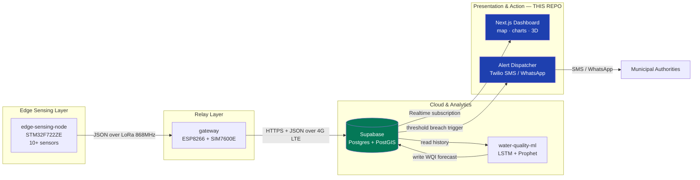
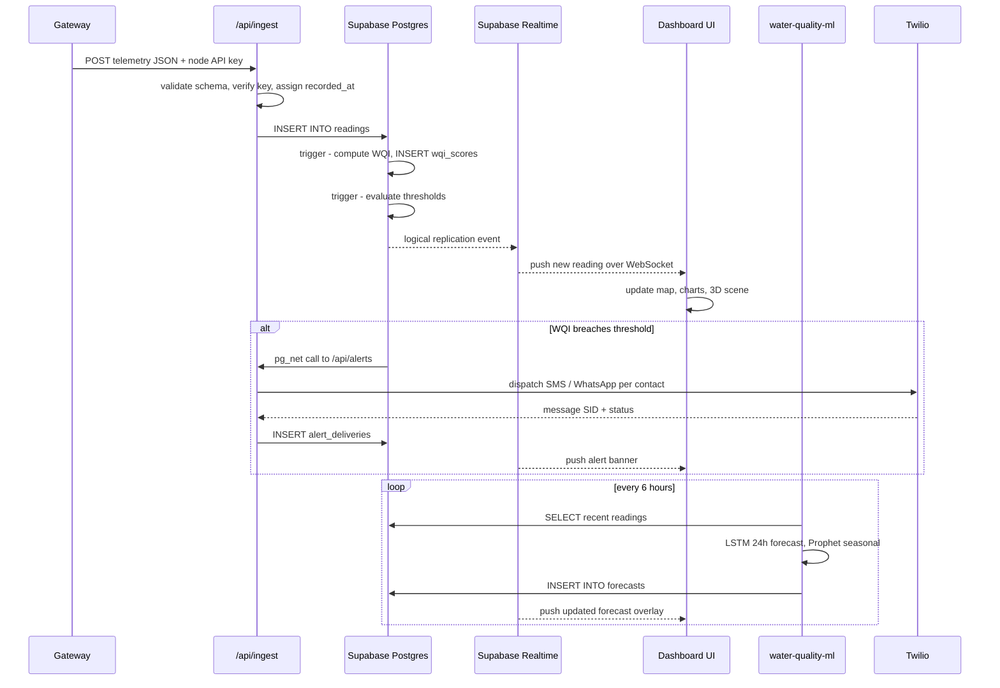
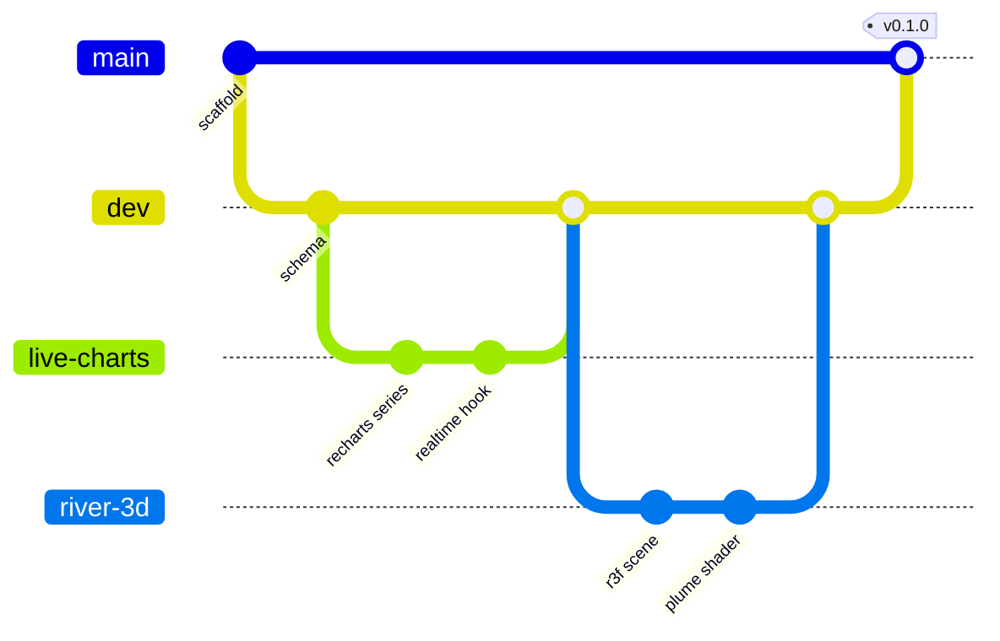

# wqm-web-dashboard

**Real-time web dashboard & backend for the WQM River Water Quality Monitor** — the presentation and action layer of the [WQM-Project](https://github.com/WQM-Project) ecosystem.

This repo owns everything a human sees or is alerted by. It ingests telemetry relayed from the [`gateway`](https://github.com/WQM-Project/gateway), persists it, renders it as live geospatial and time-series visualisations, surfaces predictions from [`water-quality-ml`](https://github.com/WQM-Project/water-quality-ml), and dispatches threshold-breach alerts to local authorities.

> [!NOTE]
> **Status: planning / scaffold.** This first commit is documentation and structure only. No application code has been written yet. The stack below is the agreed target, not a description of what currently runs.

---

## System Position



---

## What This Repo Is Responsible For

| # | Responsibility | Detail |
|---|---|---|
| 1 | **Ingestion API** | Authenticated HTTPS endpoint the gateway POSTs telemetry to. Validates, timestamps, persists. |
| 2 | **Persistence & schema** | Postgres schema, migrations, row-level security, retention policy. |
| 3 | **Realtime delivery** | Push new readings to connected browsers without polling. |
| 4 | **Geospatial visualisation** | River heatmaps, node positions, survey tracks, per-waypoint drill-down. |
| 5 | **Time-series visualisation** | Per-parameter trends, multi-parameter comparison, forecast overlay. |
| 6 | **WQI computation & display** | Current WQI, 24 h LSTM forecast, seasonal Prophet trend. |
| 7 | **Alerting** | Threshold evaluation → Twilio SMS/WhatsApp dispatch + audit log. |
| 8 | **Public access** | Read-only public view of river health; authenticated view for operators. |

---

## Tech Stack

### Frontend

| Layer | Choice | Why |
|---|---|---|
| Framework | **Next.js (App Router)** | Server Components for data-heavy pages, Route Handlers give us the ingestion + alert endpoints without a separate service, first-class Vercel deploy. |
| Language | **TypeScript** | The telemetry payload has 14 fields with distinct units — types stop unit-mixing bugs at compile time. |
| Styling | **Tailwind CSS** | Utility-first; pairs with v0.dev-generated components with zero translation. |
| Components | **shadcn/ui** | Copy-in (not a dependency) Radix primitives — accessible, fully themeable, no lock-in. |
| 3D / WebGL | **Three.js** (via React Three Fiber) | Render the river reach as a 3D scene: depth profile from `depth_cm`, pollutant plume as a shader-driven volume, boat position along the survey track. |
| Declarative 3D helpers | **@react-three/drei** | Camera controls, loaders, helpers — avoids reinventing orbit controls and GLTF loading. |
| Layout / gesture motion | **Framer Motion** | Panel transitions, shared-layout animation between map ↔ detail, drag-to-reorder widgets. |
| Timeline motion | **anime.js** | Fine-grained timeline control for the data-driven sequences Framer Motion is awkward at: SVG path draw-on for river geometry, staggered gauge sweeps, alert pulse loops. |
| Charts | **Recharts** | Per master spec. Composable, SVG-based, good enough for multi-axis time series. |
| Maps | **Leaflet** (+ `react-leaflet`) | Per master spec. `deck.gl` is the upgrade path if WebGL-accelerated heatmaps are needed at scale — see [Open Questions](#open-questions). |
| Server state | **TanStack Query** | Cache, dedupe and revalidate Supabase reads; integrates cleanly with Realtime invalidation. |
| Client state | **Zustand** | Small, unopinionated store for UI state (selected node, time window, layer toggles). |

### Backend

| Layer | Choice | Why |
|---|---|---|
| Database | **Supabase Postgres** | Relational schema, real SQL for time-series aggregation, no bucketing workaround needed. |
| Geospatial | **PostGIS** | Native `geography` type — "readings within 500 m of this bend", nearest-node, track length, all in one query. |
| Realtime | **Supabase Realtime** | Postgres logical replication → WebSocket. Browser subscribes to `readings` inserts directly. |
| Auth | **Supabase Auth** | Email + OAuth. Separates public read-only viewers from authenticated operators. |
| Authorisation | **Row Level Security** | Policy-enforced at the database, not the app — a leaked anon key still cannot write telemetry. |
| Storage | **Supabase Storage** | Trained model artefacts, exported CSV reports, node photos. |
| Scheduled jobs | **`pg_cron` + Edge Functions** | Nightly aggregation, retention pruning, forecast refresh trigger. |
| Alerting | **Twilio API** | Per master spec. SMS + WhatsApp to municipal contacts. |
| Hosting | **Vercel** | Preview deploy per PR, edge network, zero-config for Next.js. |

---

## Divergence From the Master Spec

> [!IMPORTANT]
> The [WQM master specification](https://github.com/WQM-Project/WQM) currently names **Firebase Firestore** and **React 18 + Vite**. This repo intentionally diverges on both counts. This is a **proposal to the team**, not a unilateral change — raise objections on the issue tracker before we are locked in.

### Firestore → Supabase Postgres

| Concern | Firestore | Supabase Postgres |
|---|---|---|
| Write cost at high sample rate | Per-document billing forced the **"data bucketing"** workaround in the master spec — aggregating a whole mission into one document purely to dodge write costs. | Row-per-reading is the natural model. No schema distortion for billing reasons. |
| Geospatial queries | No native geo type. Radius queries need geohash libraries and client-side filtering. | **PostGIS.** `ST_DWithin`, `ST_Length`, nearest-neighbour — server-side and indexed. This is a river monitoring project; geospatial is not optional. |
| Time-series aggregation | No `GROUP BY`, no window functions. Hourly/daily rollups must be precomputed in Cloud Functions. | `date_trunc` + window functions. Rollups are a materialized view. |
| ML pipeline integration | `water-quality-ml` would consume a document API. | Pandas reads Postgres directly (`read_sql`). Forecasts write back to a table. Far less glue code. |
| Schema guarantees | Schemaless — a firmware field rename silently corrupts the dataset. | Typed columns + constraints. A malformed payload is rejected at insert. |
| Portability | Proprietary. | Plain Postgres — self-hostable, dumpable, portable. |

**Cost of diverging:** the gateway's upload target changes (one URL + auth header), and any Firebase code already written in sibling repos needs revisiting. Worth confirming with the gateway owner early.

### React + Vite → Next.js

The master spec's "React 18 SPA" predates two requirements that have since appeared:

1. **A server-side ingestion endpoint** for the gateway to POST to. A Vite SPA is static — it needs a separate backend service. Next.js Route Handlers give us this in the same deployment.
2. **A server-side alert dispatcher** holding the Twilio credentials. Same reasoning — these must never reach the browser bundle.

Next.js is still React 18+. Component-level work carries over unchanged.

---

## Telemetry Contract

The gateway relays the packet emitted by [`edge-sensing-node`](https://github.com/WQM-Project/edge-sensing-node). This is the **authoritative input shape** — the database schema below is derived from it field-for-field.

```json
{
  "id": "WQM-001",
  "ts": 123456789,
  "pH": 7.12,
  "turb_ntu": 42.5,
  "tds_ppm": 310.0,
  "do_mgl": 6.85,
  "ec_uscm": 680.2,
  "orp_mv": 215.0,
  "temp_w1": 23.50,
  "temp_w2": 23.48,
  "depth_cm": 35.2,
  "temp_air": 28.60,
  "humidity": 65.3,
  "pressure_hpa": 1013.25
}
```

| Field | Type | Unit | Notes |
|---|---|---|---|
| `id` | `text` | — | Node identifier; supports multi-node deployment. |
| `ts` | `bigint` | ms | `HAL_GetTick()` — **milliseconds since node boot, not epoch.** See [Open Questions](#open-questions). |
| `pH` | `real` | 0–14 | Two-point calibrated. |
| `turb_ntu` | `real` | NTU | Quadratic polynomial fit. |
| `tds_ppm` | `real` | ppm | Temperature-compensated. |
| `do_mgl` | `real` | mg/L | Pressure + temperature compensated. |
| `ec_uscm` | `real` | µS/cm | Electrical conductivity. |
| `orp_mv` | `real` | mV | Oxidation-reduction potential. |
| `temp_w1` / `temp_w2` | `real` | °C | Primary + backup water temperature (DS18B20). |
| `depth_cm` | `real` | cm | Ultrasonic water level (JSN-SR04T). |
| `temp_air` / `humidity` / `pressure_hpa` | `real` | °C / % / hPa | Atmospheric (BME280). |

---

## Database Schema

```mermaid
erDiagram
    NODES ||--o{ READINGS : "emits"
    NODES ||--o{ MISSIONS : "runs"
    MISSIONS ||--o{ READINGS : "groups"
    READINGS ||--o| WQI_SCORES : "scored as"
    NODES ||--o{ FORECASTS : "predicted for"
    NODES ||--o{ ALERTS : "raises"
    THRESHOLDS ||--o{ ALERTS : "triggers"
    ALERTS ||--o{ ALERT_DELIVERIES : "fans out to"
    CONTACTS ||--o{ ALERT_DELIVERIES : "receives"

    NODES {
        uuid id PK
        text device_id UK
        text label
        text river
        geography home_point
        timestamptz commissioned_at
        bool active
    }
    READINGS {
        bigint id PK
        uuid node_id FK
        uuid mission_id FK
        timestamptz recorded_at
        bigint node_uptime_ms
        geography location
        real ph
        real turbidity_ntu
        real tds_ppm
        real do_mgl
        real ec_uscm
        real orp_mv
        real temp_water_c
        real temp_water_backup_c
        real depth_cm
        real temp_air_c
        real humidity_pct
        real pressure_hpa
    }
    MISSIONS {
        uuid id PK
        uuid node_id FK
        timestamptz started_at
        timestamptz ended_at
        text stage
        jsonb waypoints
    }
    WQI_SCORES {
        bigint reading_id PK
        real wqi
        text band
        jsonb sub_indices
    }
    FORECASTS {
        uuid id PK
        uuid node_id FK
        timestamptz generated_at
        timestamptz target_at
        real predicted_wqi
        real confidence_low
        real confidence_high
        text model
    }
    THRESHOLDS {
        uuid id PK
        text parameter
        real min_ok
        real max_ok
        text severity
        text standard
    }
    ALERTS {
        uuid id PK
        uuid node_id FK
        uuid threshold_id FK
        bigint reading_id FK
        timestamptz raised_at
        text severity
        text message
        bool acknowledged
    }
    CONTACTS {
        uuid id PK
        text name
        text phone_e164
        text channel
        text authority
        bool active
    }
    ALERT_DELIVERIES {
        uuid id PK
        uuid alert_id FK
        uuid contact_id FK
        timestamptz sent_at
        text twilio_sid
        text status
    }
```



**Design notes**

- `recorded_at` is assigned **server-side on ingest**; `node_uptime_ms` preserves the raw `ts` for clock-drift analysis. We do not trust boot-relative time as a timestamp.
- `location` is PostGIS `geography(Point, 4326)` — a GiST index makes heatmap viewport queries fast.
- `WQI_SCORES` is separate from `READINGS` so the WQI formula can be revised and backfilled without touching raw sensor data. **Raw readings are immutable.**
- `ALERT_DELIVERIES` is separate from `ALERTS` so one breach fanning out to eight contacts becomes eight auditable delivery rows with individual Twilio SIDs.
- `MISSIONS.stage` distinguishes Stage 1 (RC) from Stage 2 (autonomous) survey runs.

---

## Data Flow



---

## Features

### MVP — v0.1

- [ ] Authenticated ingestion endpoint accepting the gateway payload
- [ ] Postgres schema, migrations and RLS policies
- [ ] Node list with online/offline status and last-seen
- [ ] Live readings table with realtime insert streaming
- [ ] Per-parameter time-series chart (Recharts), selectable time window
- [ ] Leaflet map with node markers and latest-reading popups
- [ ] Current WQI gauge with colour-coded band
- [ ] Public read-only view + authenticated operator view

### v0.2 — Analysis

- [ ] Geographic heatmap layer (WQI interpolated across the survey track)
- [ ] Mission replay — scrub a survey timeline and watch values change
- [ ] Multi-parameter comparison with correlation view
- [ ] 24 h LSTM forecast overlaid on the live series with confidence band
- [ ] Prophet seasonal decomposition view
- [ ] Threshold editor (per-parameter, per-standard)
- [ ] CSV / report export

### v0.3 — Alerting & 3D

- [ ] Twilio SMS + WhatsApp dispatch with delivery audit trail
- [ ] Contact management and escalation rules
- [ ] In-dashboard alert feed with acknowledgement
- [ ] **Three.js river scene** — depth-profiled riverbed driven by `depth_cm`, animated flow
- [ ] **Shader-driven pollutant plume** — WQI drives a fragment-shader colour field
- [ ] **3D boat track** — animate node position along the mission path
- [ ] anime.js timelines for gauge sweeps, SVG river draw-on, alert pulse

### Backlog

- [ ] Multi-node / multi-river support
- [ ] Stage 2 waypoint planner — draw a route, push it to the autonomous boat
- [ ] Anomaly annotation and operator notes
- [ ] PWA offline mode for field use
- [ ] i18n (English / Hindi)

---

## Route Map

| Route | Access | Purpose |
|---|---|---|
| `/` | Public | Landing — river health summary, current WQI, headline chart |
| `/overview` | Public | Dashboard grid — gauges, live series, alert feed |
| `/map` | Public | Leaflet map, heatmap layers, track overlay, node drill-down |
| `/map/3d` | Public | Three.js river scene with plume visualisation |
| `/nodes` | Auth | Node fleet — health, calibration state, last-seen |
| `/nodes/[deviceId]` | Auth | Single node — full history, raw packets, diagnostics |
| `/missions/[id]` | Auth | Mission replay and export |
| `/alerts` | Auth | Alert history, acknowledgement, contacts, thresholds |
| `/api/ingest` | Node key | `POST` — gateway telemetry ingestion |
| `/api/alerts` | Service | `POST` — internal alert dispatch, called by `pg_net` |

---

## Repository Structure

```
wqm-web-dashboard/
├── app/
│   ├── (dashboard)/
│   │   ├── overview/          # gauge grid, live series, alert feed
│   │   ├── map/               # Leaflet + 3D river scene
│   │   ├── nodes/             # fleet + per-node drill-down
│   │   └── alerts/            # alert history, thresholds, contacts
│   └── api/
│       ├── ingest/            # gateway -> Postgres
│       └── alerts/            # threshold breach -> Twilio
├── components/
│   ├── charts/                # Recharts wrappers
│   ├── map/                   # Leaflet layers, heatmap, markers
│   ├── three/                 # R3F scene, shaders, river mesh
│   ├── layout/                # shell, nav, theme
│   └── ui/                    # shadcn/ui primitives
├── lib/
│   ├── supabase/              # browser + server clients, typed queries
│   ├── wqi/                   # WQI formula, sub-indices, banding
│   └── utils/                 # units, formatters, time helpers
├── hooks/                     # useRealtimeReadings, useNodeStatus, ...
├── types/                     # telemetry + generated DB types
├── styles/
├── public/models/             # GLTF assets for the 3D scene
├── supabase/
│   ├── migrations/            # versioned SQL
│   └── functions/             # Edge Functions
└── docs/                      # ADRs, calibration notes, API reference
```

---

## Local Development

```bash
git clone https://github.com/WQM-Project/wqm-web-dashboard.git
cd wqm-web-dashboard
npm install
cp .env.example .env.local
npx supabase start
npx supabase db reset
npm run dev
```

Then open `http://localhost:3000`.

**Prerequisites:** Node.js 20+, Docker (for local Supabase), Supabase CLI.

### Environment Variables

| Variable | Scope | Purpose |
|---|---|---|
| `NEXT_PUBLIC_SUPABASE_URL` | Client | Supabase project URL |
| `NEXT_PUBLIC_SUPABASE_ANON_KEY` | Client | Anon key — RLS-restricted, safe to expose |
| `SUPABASE_SERVICE_ROLE_KEY` | **Server only** | Bypasses RLS. Never expose to the browser. |
| `GATEWAY_INGEST_KEY` | Server | Shared secret the gateway sends on `/api/ingest` |
| `TWILIO_ACCOUNT_SID` | Server | Twilio account identifier |
| `TWILIO_AUTH_TOKEN` | **Server only** | Twilio auth token |
| `TWILIO_FROM_NUMBER` | Server | Sending number (E.164) |
| `TWILIO_WHATSAPP_FROM` | Server | WhatsApp sender |

---

## Deployment

Vercel, connected to this repository.

| Branch | Environment | URL |
|---|---|---|
| `main` | Production | _TBD_ |
| `dev` | Staging | _TBD_ |
| PR branches | Preview | auto-generated per PR |

Pushing to `main` deploys to production. Environment variables are configured in the Vercel project and are **not** committed.

---

## Development Workflow



- `main` — protected, always deployable. Merges from `dev` only.
- `dev` — integration branch. Feature branches merge here via pull request.
- `feat/*`, `fix/*`, `docs/*` — short-lived, one concern each.
- Conventional Commits (`feat:`, `fix:`, `docs:`, `chore:`).
- Every PR gets a Vercel preview deployment. Review against the preview, not a local build.

---

## Open Questions

These need answers from the wider team before implementation locks in.

| # | Question | Blocks | Owner |
|---|---|---|---|
| 1 | **Backend switch to Supabase** — is the team agreed? The gateway's upload target changes. | Schema, ingestion | Gateway owner + ML |
| 2 | **GPS coordinates are absent from the telemetry packet.** The master spec specifies a NEO-6M for geotagging, but the `edge-sensing-node` JSON has no `lat` / `lon` field. Without them there is no map layer. | Map, heatmap, PostGIS | Edge node owner |
| 3 | **`ts` is `HAL_GetTick()`** — milliseconds since boot, not epoch. Server-side timestamping covers the normal case, but packets buffered during a LoRa outage would be misattributed in time. Should the node carry an RTC? | Time-series accuracy | Edge node owner |
| 4 | **WQI formula** — which standard, and what sub-index weightings? Bands must be confirmed against IS 10500 / CPCB before anything is displayed as authoritative. | WQI display, thresholds | ML + domain lead |
| 5 | **Alert recipients and escalation policy** — who is contacted, at what severity, and with what cool-down to prevent alert storms? | Twilio integration | Project lead |
| 6 | **Leaflet vs deck.gl** — Leaflet is in the master spec, but WebGL-accelerated heatmaps scale better with dense survey tracks. Decide before the map layer is built. | Map implementation | This repo |
| 7 | **Data retention** — how long are raw readings kept at full resolution before downsampling? | Schema, cost | Project lead |

---

## Related Repositories

| Repo | Layer | Description |
|---|---|---|
| [WQM](https://github.com/WQM-Project/WQM) | Spec | Master project specification |
| [edge-sensing-node](https://github.com/WQM-Project/edge-sensing-node) | Edge | STM32 firmware, sensor acquisition |
| [gateway](https://github.com/WQM-Project/gateway) | Relay | ESP8266 + SIM7600E LoRa-to-4G bridge |
| [water-quality-ml](https://github.com/WQM-Project/water-quality-ml) | Analytics | LSTM forecasting, Prophet trends |
| [wqm-mechanical](https://github.com/WQM-Project/wqm-mechanical) | Hardware | Catamaran hull CAD |
| **wqm-web-dashboard** | Presentation | **This repo** |

---

## License

TBD — to be aligned with the rest of the WQM-Project organisation.
