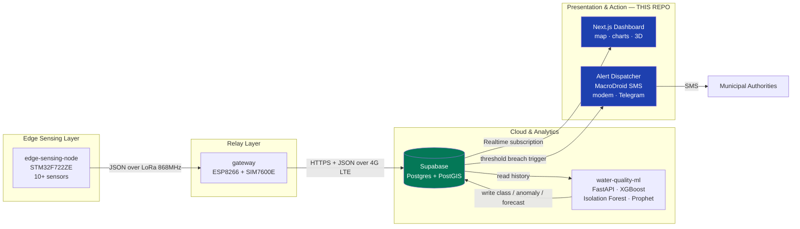
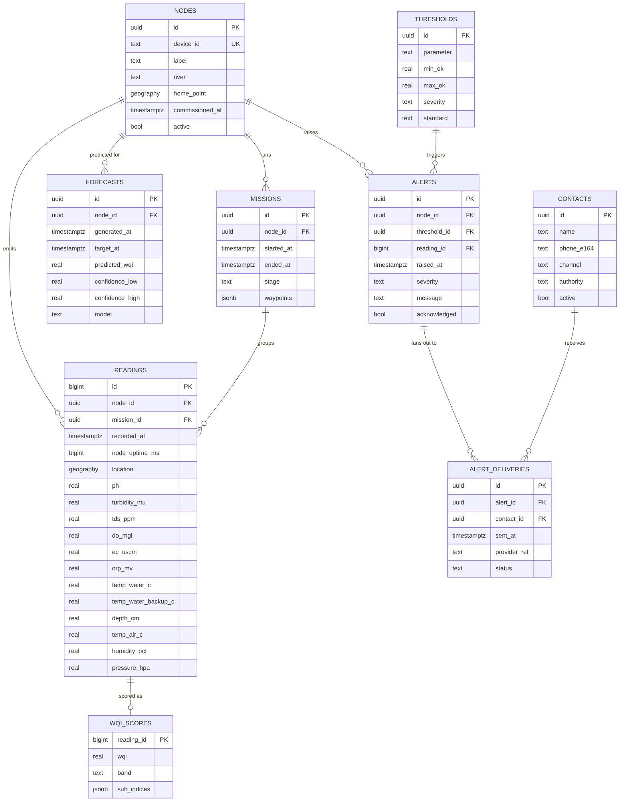
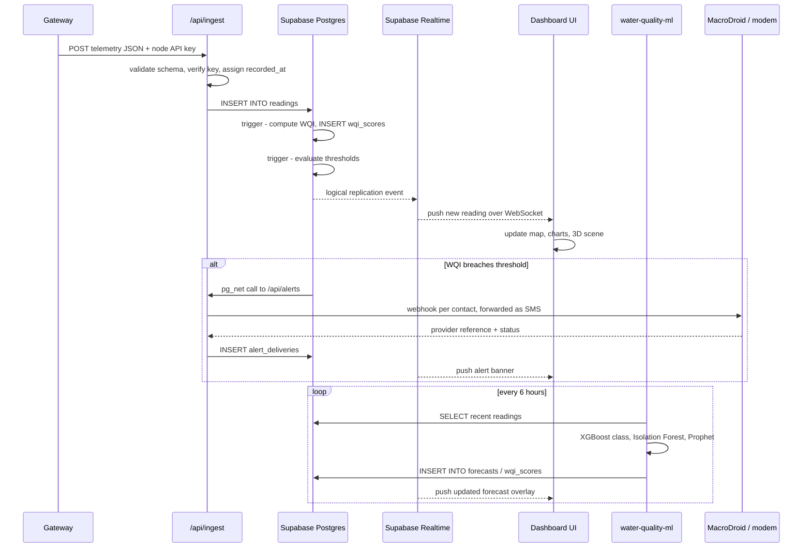
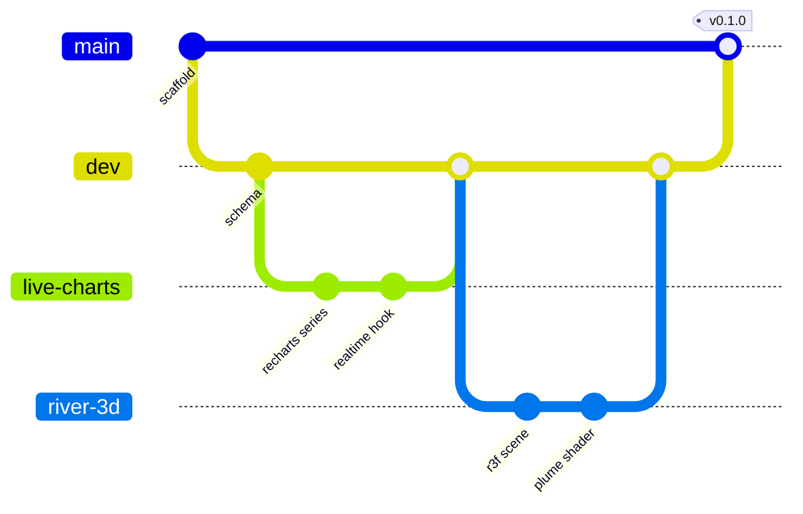

# wqm-web-dashboard

**Real-time web dashboard & backend for the WQM River Water Quality Monitor** — the presentation and action layer of the [WQM-Project](https://github.com/WQM-Project) ecosystem.

This repo owns everything a human sees or is alerted by. It ingests telemetry relayed from the [`gateway`](https://github.com/WQM-Project/gateway), persists it, renders it as live geospatial and time-series visualisations, surfaces predictions from [`water-quality-ml`](https://github.com/WQM-Project/water-quality-ml), and dispatches threshold-breach alerts to local authorities.

> [!NOTE]
> **Status: early.** The public landing page is built and deployable; the operator dashboard itself is not. The stack below is the agreed target, not a description of what already runs.

**Context** — Design Practicum, Team WQM, IIT Mandi. This repository is the data and dashboard workstream.

---

## System Position



---

## What This Repo Is Responsible For

| # | Responsibility | Detail |
|---|---|---|
| 1 | **Ingestion API** | Authenticated HTTPS endpoint the gateway POSTs telemetry to. Validates, timestamps, persists. |
| 2 | **Persistence & schema** | Postgres schema, migrations, row-level security, retention policy. |
| 3 | **Realtime delivery** | Push new readings to connected browsers without polling. |
| 4 | **Geospatial visualisation** | River heatmaps, node positions, survey tracks, per-waypoint drill-down. |
| 5 | **Time-series visualisation** | Per-parameter trends, multi-parameter comparison, forecast overlay. |
| 6 | **Quality grading & display** | Current class from the XGBoost model, anomaly flags, Prophet trend forecast. |
| 7 | **Alerting** | Threshold evaluation → SMS to authorities via MacroDroid, with a delivery audit log per recipient. |
| 8 | **Public access** | Read-only public view of river health; authenticated view for operators. |

---

## Tech Stack

### Frontend

| Layer | Choice | Why |
|---|---|---|
| Framework | **Next.js (App Router)** | Server Components for data-heavy pages, Route Handlers give us the ingestion + alert endpoints without a separate service, first-class Vercel deploy. |
| Language | **TypeScript** | The telemetry payload has 14 fields with distinct units — types stop unit-mixing bugs at compile time. |
| Styling | **Tailwind CSS** | Utility-first; pairs with v0.dev-generated components with zero translation. |
| Components | **shadcn/ui** | Copy-in (not a dependency) Radix primitives — accessible, fully themeable, no lock-in. |
| 3D / WebGL | **Three.js** (via React Three Fiber) | Render the river reach as a 3D scene: depth profile from `depth_cm`, pollutant plume as a shader-driven volume, boat position along the survey track. |
| Declarative 3D helpers | **@react-three/drei** | Camera controls, loaders, helpers — avoids reinventing orbit controls and GLTF loading. |
| Layout / gesture motion | **Framer Motion** | Panel transitions, shared-layout animation between map ↔ detail, drag-to-reorder widgets. |
| Timeline motion | **anime.js** | Fine-grained timeline control for the data-driven sequences Framer Motion is awkward at: SVG path draw-on for river geometry, staggered gauge sweeps, alert pulse loops. |
| Charts | **Recharts** | Per master spec. Composable, SVG-based, good enough for multi-axis time series. |
| Maps | **Leaflet** (+ `react-leaflet`) | Per master spec. `deck.gl` is the upgrade path if WebGL-accelerated heatmaps are needed at scale — see [Open Questions](#open-questions). |
| Server state | **TanStack Query** | Cache, dedupe and revalidate Supabase reads; integrates cleanly with Realtime invalidation. |
| Client state | **Zustand** | Small, unopinionated store for UI state (selected node, time window, layer toggles). |

### Backend

| Layer | Choice | Why |
|---|---|---|
| Database | **Supabase Postgres** | Relational schema, real SQL for time-series aggregation, no bucketing workaround needed. |
| Geospatial | **PostGIS** | Native `geography` type — "readings within 500 m of this bend", nearest-node, track length, all in one query. |
| Realtime | **Supabase Realtime** | Postgres logical replication → WebSocket. Browser subscribes to `readings` inserts directly. |
| Auth | **Supabase Auth** | Email + OAuth. Separates public read-only viewers from authenticated operators. |
| Authorisation | **Row Level Security** | Policy-enforced at the database, not the app — a leaked anon key still cannot write telemetry. |
| Storage | **Supabase Storage** | Trained model artefacts, exported CSV reports, node photos. |
| Scheduled jobs | **`pg_cron` + Edge Functions** | Nightly aggregation, retention pruning, forecast refresh trigger. |
| Alerting | **MacroDroid SMS** (primary), onboard modem, Telegram (internal) | Twilio dropped on cost; SMS is the only channel Indian municipal recipients reliably read — see [Alerting Without Twilio](#alerting-without-twilio). |
| ML inference | **FastAPI service** | `water-quality-ml` exposes `/predict`, `/forecast`, `/health` on port 8000. The dashboard calls it server-side. |
| Hosting | **Vercel** | Preview deploy per PR, edge network, zero-config for Next.js. |

---

## Divergence From the Master Spec

> [!IMPORTANT]
> The [WQM master specification](https://github.com/WQM-Project/WQM) currently names **Firebase Firestore** and **React 18 + Vite**. This repo intentionally diverges on both counts. This is a **proposal to the team**, not a unilateral change — raise objections on the issue tracker before we are locked in.

### Firestore → Supabase Postgres

| Concern | Firestore | Supabase Postgres |
|---|---|---|
| Write cost at high sample rate | Per-document billing forced the **"data bucketing"** workaround in the master spec — aggregating a whole mission into one document purely to dodge write costs. | Row-per-reading is the natural model. No schema distortion for billing reasons. |
| Geospatial queries | `GeoPoint` stores a coordinate but supports no spatial predicates — radius queries need geohash libraries and client-side filtering. | **PostGIS.** `ST_DWithin`, `ST_Length`, nearest-neighbour — server-side and indexed. This is a river monitoring project; geospatial is not optional. |
| Realtime push | `onSnapshot` listeners — genuinely good, and a fair part of why the team chose Firestore. | Supabase Realtime is the direct equivalent: logical replication out to a WebSocket. Nothing is lost here. |
| Time-series aggregation | No `GROUP BY`, no window functions. Hourly/daily rollups must be precomputed in Cloud Functions. | `date_trunc` + window functions. Rollups are a materialized view. |
| ML pipeline integration | `water-quality-ml` would consume a document API. | Pandas reads Postgres directly (`read_sql`). Forecasts write back to a table. Far less glue code. |
| Schema guarantees | Schemaless — a firmware field rename silently corrupts the dataset. | Typed columns + constraints. A malformed payload is rejected at insert. |
| Portability | Proprietary. | Plain Postgres — self-hostable, dumpable, portable. |

**Cost of diverging:** the gateway's upload target changes (one URL + auth header), and any Firebase code already written in sibling repos needs revisiting. Worth confirming with the gateway owner early.

### React + Vite → Next.js

The master spec's "React 18 SPA" predates two requirements that have since appeared:

1. **A server-side ingestion endpoint** for the gateway to POST to. A Vite SPA is static — it needs a separate backend service. Next.js Route Handlers give us this in the same deployment.
2. **A server-side alert dispatcher** holding the Telegram bot token and modem credentials. Same reasoning — these must never reach the browser bundle.

Next.js is still React 18+. Component-level work carries over unchanged.

---

## Alerting Without Twilio

> [!IMPORTANT]
> **Twilio has been dropped on cost grounds.** It bills per message — a recurring expense this project cannot carry. Any Twilio reference still in the master specification is stale.

The replacement is not a like-for-like swap, because the constraint is not only cost. Two things have to be true at once: the message must arrive as **SMS** (what municipal officials in India actually read — Telegram and WhatsApp are not realistic channels for a government recipient), and the dashboard must be able to **trigger it from a serverless host**.

Only one channel satisfies both.

| Priority | Channel | Mechanism | Cost | Can Vercel trigger it? | Arrives as |
|---|---|---|---|---|---|
| **1. Primary** | **MacroDroid forwarding** | An HTTP trigger hits a MacroDroid rule on a dedicated Android handset, which sends SMS from that handset's own SIM. | Free app + ordinary carrier SMS | **Yes** — plain webhook | **SMS** |
| 2. Fallback | **Onboard modem SMS** | The gateway's SIM7600E / A7670C is driven over UART AT commands (`AT+CMGS`). | Carrier SMS only — hardware already owned | No — the modem is on the riverbank, not the web host | **SMS** |
| 3. Internal only | **Telegram Bot API** | `POST /sendMessage` with a bot token. | Free | Yes | Telegram message |

**Why MacroDroid is primary.** It is the only path where the channel the dashboard can actually reach and the channel the recipient actually reads are the same channel. The modem sends real SMS too, but a serverless function cannot open a serial port two hundred kilometres away — reaching it means calling back to the gateway and depending on the gateway's uplink being alive. MacroDroid needs only a handset with signal and a data connection.

**Telegram is demoted to an internal channel.** It is free and carries a richer payload — coordinates, charts, a link straight into the dashboard — which makes it genuinely useful for the *team's* own monitoring. It is not an authority-facing channel and should not be counted as one in any deliverable.

**What this means for this repo**

- No Twilio SDK and no `TWILIO_*` credentials anywhere.
- `alert_deliveries` records a `channel` (`sms_macrodroid` | `sms_modem` | `telegram`) and a `provider_ref` rather than a vendor message SID, because there is no longer a single vendor.
- The handset is now infrastructure. It needs power, credit and signal, and its liveness should be monitored like any other node — a silent handset means silent alerts. See Open Question 8.

---

## Telemetry Contract

The gateway relays the packet emitted by [`edge-sensing-node`](https://github.com/WQM-Project/edge-sensing-node). This is the **authoritative input shape** — the database schema below is derived from it field-for-field.

```json
{
  "id": "WQM-001",
  "ts": 123456789,
  "pH": 7.12,
  "turb_ntu": 42.5,
  "tds_ppm": 310.0,
  "do_mgl": 6.85,
  "ec_uscm": 680.2,
  "orp_mv": 215.0,
  "temp_w1": 23.50,
  "temp_w2": 23.48,
  "depth_cm": 35.2,
  "temp_air": 28.60,
  "humidity": 65.3,
  "pressure_hpa": 1013.25
}
```

| Field | Type | Unit | Notes |
|---|---|---|---|
| `id` | `text` | — | Node identifier; supports multi-node deployment. |
| `ts` | `bigint` | ms | `HAL_GetTick()` — **milliseconds since node boot, not epoch.** See [Open Questions](#open-questions). |
| `pH` | `real` | 0–14 | Two-point calibrated. |
| `turb_ntu` | `real` | NTU | Quadratic polynomial fit. |
| `tds_ppm` | `real` | ppm | Temperature-compensated. |
| `do_mgl` | `real` | mg/L | Pressure + temperature compensated. |
| `ec_uscm` | `real` | µS/cm | Electrical conductivity. |
| `orp_mv` | `real` | mV | Oxidation-reduction potential. |
| `temp_w1` / `temp_w2` | `real` | °C | Primary + backup water temperature (DS18B20). |
| `depth_cm` | `real` | cm | Ultrasonic water level (JSN-SR04T). |
| `temp_air` / `humidity` / `pressure_hpa` | `real` | °C / % / hPa | Atmospheric (BME280). |

---

## Upstream Contract Reconciliation

> [!WARNING]
> Four different shapes for the same readings exist across the project's own documents and repositories, and they do not agree. This repo sits downstream of all of them, so these need reconciling before the schema is migrated.

| Source | Shape |
|---|---|
| **A. Firmware** — [`edge-sensing-node`](https://github.com/WQM-Project/edge-sensing-node) | `id`, `ts`, `pH`, `turb_ntu`, `tds_ppm`, `do_mgl`, `ec_uscm`, `orp_mv`, `temp_w1`, `temp_w2`, `depth_cm`, `temp_air`, `humidity`, `pressure_hpa` |
| **B. Dashboard spec** — Design Practicum summary | `node_id`, `timestamp` (ISO 8601), `location{lat,lng}`, `pH`, `turbidity_ntu`, `tds_ppm`, `temperature_c`, `dissolved_oxygen_mgL`, `conductivity_msCm`, `orp_mv`, `battery_v` |
| **C. ML features** — [`water-quality-ml`](https://github.com/WQM-Project/water-quality-ml) README | pH, Turbidity, Conductivity, Dissolved Oxygen, **Chlorides**, ORP, Temperature — 7 features, TDS deliberately dropped |
| **D. ML API input** — `water-quality-ml/src/api.py` | `ph`, `Hardness`, `Solids`, `Chloramines`, `Sulfate`, `Conductivity`, `Organic_carbon`, `Trihalomethanes`, `Turbidity` |

### The specific conflicts

| # | Conflict | Consequence |
|---|---|---|
| 1 | **No GPS in the firmware packet.** B specifies `location{lat,lng}` and the master spec lists a NEO-6M; A has no `lat` / `lon` field. | Map View — the headline dashboard feature — has nothing to plot. **Blocking.** |
| 2 | **No battery voltage in the firmware packet.** B has `battery_v`; A does not. | Node Health view cannot show battery state. |
| 3 | **Conductivity unit mismatch.** A sends `ec_uscm` (µS/cm); B specifies `conductivity_msCm` (mS/cm). | A silent 1000x error. `680.2 µS/cm` read as mS/cm is off by three orders of magnitude and would still plot as a plausible-looking line. |
| 4 | **Timestamp semantics.** A sends `HAL_GetTick()` — ms since boot; B specifies an ISO 8601 UTC instant. | Readings cannot be ordered across a node reboot without server-side timestamping. |
| 5 | **Chlorides required but never measured.** C lists Chlorides as a feature that measurably improved accuracy; there is no chloride sensor in the suite. | The v2 model cannot be fed live data as specified. |
| 6 | **TDS measured but discarded.** C drops TDS as a perfect linear derivative of EC (`TDS = EC x 0.65`, 0.000% information gain), yet A still transmits it. | Harmless, but it should be stored as a derived value rather than treated as an independent measurement. |
| 7 | **The ML API does not accept the boat's payload.** D is the Kaggle water-potability schema — Hardness, Sulfate, Trihalomethanes — with the boat's own parameters marked optional and *"not in training data"*. The `river_beas_v2` models are committed, but `api.py` still loads `kaggle_v1`. | The dashboard cannot call `/predict` with a real packet today. **Blocking** for the grading feature. |

**Position taken here:** shape **A** is authoritative, because it is the only one that physically exists — it is what the hardware actually transmits today. The schema below mirrors A field-for-field, adds a server-assigned `recorded_at`, and pre-declares nullable `location` and `battery_v` columns so no migration is needed the day the firmware starts sending them.

---

## Database Schema



**Design notes**

- `recorded_at` is assigned **server-side on ingest**; `node_uptime_ms` preserves the raw `ts` for clock-drift analysis. We do not trust boot-relative time as a timestamp.
- `location` is PostGIS `geography(Point, 4326)` — a GiST index makes heatmap viewport queries fast.
- `WQI_SCORES` is separate from `READINGS` so the WQI formula can be revised and backfilled without touching raw sensor data. **Raw readings are immutable.**
- `ALERT_DELIVERIES` is separate from `ALERTS` so one breach fanning out to eight contacts becomes eight auditable delivery rows, each with the sending channel and that channel's own reference (a modem message reference, a Telegram message id).
- `MISSIONS.stage` distinguishes Stage 1 (RC) from Stage 2 (autonomous) survey runs.

---

## Data Flow



---

## Dashboard Views

The five views agreed in the Design Practicum data & dashboard summary, mapped onto this app's routes.

| View | Route | Contents | Blocked by |
|---|---|---|---|
| **Map View** | `/map` | Leaflet pin per node, coloured by live quality class; click for a mini trend popup | Conflict 1 — no GPS |
| **Time-Series** | `/overview` | Per-parameter charts at 24 h / 7 d / 30 d, with CPCB and IS 10500 threshold lines overlaid | — |
| **Quality + Forecast** | `/overview` | Live quality class, with the Prophet forecast as a dashed line | Prophet not yet implemented upstream |
| **Alerts Log** | `/alerts` | Breach history — timestamp, node, parameter, channel used, delivery status | — |
| **Node Health** | `/nodes` | Battery voltage, last-seen time, signal strength per node | Conflict 2 — no `battery_v` |

---

## ML Integration

`water-quality-ml` ships a **FastAPI service**, not a library, so integration is over HTTP.

| Endpoint | Method | Purpose |
|---|---|---|
| `/predict` | POST | Classification + anomaly detection for one reading |
| `/forecast` | GET | Forecast for a single parameter |
| `/forecast/all` | GET | Forecast every parameter |
| `/health` | GET | Liveness check |
| `/docs` | GET | Swagger UI |

**The models behind it**

| Model | Type | Output |
|---|---|---|
| Classification | XGBoost | `Excellent` / `Good` / `Poor` / `Dangerous`, sub-millisecond inference |
| Anomaly — layer 1 | Deterministic rules | CPCB / BIS hard thresholds. Runs first, cannot fail. |
| Anomaly — layer 2 | Isolation Forest | Flags implausible *combinations* that pass every individual rule — an invisible solvent with normal pH and turbidity but abnormal conductivity |
| Forecasting | Prophet | 24–72 h trend. Not yet implemented upstream. |

**Integration notes**

- **There is no LSTM.** The master spec's "LSTM 24 h WQI prediction" was superseded: grading is XGBoost, forecasting is Prophet. Worth correcting upstream.
- **Grading returns a class, not a 0–100 index.** Any UI assuming a numeric gauge has to render a four-level categorical instead. `wqi_scores` keeps both — `band` for the class, `wqi` nullable until a numeric index is actually defined.
- The service sets `allow_origins=["*"]`. The browser must therefore **never** call it directly in production; requests route through this app's `/api/` layer so the ML service can be firewalled to a single origin.
- The pipeline deliberately avoids the textbook WQI formula because it needs BOD and COD — lab measurements with a 3–5 day turnaround. The classifier infers lab-grade quality from cheap sensors instead. That distinction belongs in the UI copy too: the dashboard shows an *inferred* grade, not a measured index.

---

## Features

### MVP — v0.1

- [ ] Authenticated ingestion endpoint accepting the gateway payload
- [ ] Postgres schema, migrations and RLS policies
- [ ] Node list with online/offline status and last-seen
- [ ] Live readings table with realtime insert streaming
- [ ] Per-parameter time-series chart (Recharts), selectable time window
- [ ] Leaflet map with node markers and latest-reading popups
- [ ] Current quality class (Excellent / Good / Poor / Dangerous) with colour coding
- [ ] Node health panel — battery voltage, last-seen, signal strength
- [ ] Public read-only view + authenticated operator view

### v0.2 — Analysis

- [ ] Geographic heatmap layer (WQI interpolated across the survey track)
- [ ] Mission replay — scrub a survey timeline and watch values change
- [ ] Multi-parameter comparison with correlation view
- [ ] Prophet forecast overlaid on the live series with confidence band
- [ ] Seasonal decomposition view
- [ ] Anomaly feed — rule breaches and Isolation Forest flags, side by side
- [ ] Threshold editor (per-parameter, per-standard)
- [ ] CSV / report export

### v0.3 — Alerting & 3D

- [ ] MacroDroid webhook dispatch, with per-recipient delivery audit trail
- [ ] Onboard modem SMS as fallback when the handset is unreachable
- [ ] Handset liveness monitoring — a silent handset must raise its own alarm
- [ ] Telegram channel for internal team monitoring
- [ ] Contact management and escalation rules
- [ ] In-dashboard alert feed with acknowledgement
- [ ] **Three.js river scene** — depth-profiled riverbed driven by `depth_cm`, animated flow
- [ ] **Shader-driven pollutant plume** — WQI drives a fragment-shader colour field
- [ ] **3D boat track** — animate node position along the mission path
- [ ] anime.js timelines for gauge sweeps, SVG river draw-on, alert pulse

### Backlog

- [ ] Multi-node / multi-river support
- [ ] Stage 2 waypoint planner — draw a route, push it to the autonomous boat
- [ ] Anomaly annotation and operator notes
- [ ] PWA offline mode for field use
- [ ] i18n (English / Hindi)

---

## Route Map

| Route | Access | Purpose |
|---|---|---|
| `/` | Public | Landing — river health summary, current WQI, headline chart |
| `/overview` | Public | Dashboard grid — gauges, live series, alert feed |
| `/map` | Public | Leaflet map, heatmap layers, track overlay, node drill-down |
| `/map/3d` | Public | Three.js river scene with plume visualisation |
| `/nodes` | Auth | Node fleet — health, calibration state, last-seen |
| `/nodes/[deviceId]` | Auth | Single node — full history, raw packets, diagnostics |
| `/missions/[id]` | Auth | Mission replay and export |
| `/alerts` | Auth | Alert history, acknowledgement, contacts, thresholds |
| `/api/ingest` | Node key | `POST` — gateway telemetry ingestion |
| `/api/alerts` | Service | `POST` — internal alert dispatch via MacroDroid webhook, called by `pg_net` |

---

## Repository Structure

```
wqm-web-dashboard/
├── app/
│   ├── (dashboard)/
│   │   ├── overview/          # gauge grid, live series, alert feed
│   │   ├── map/               # Leaflet + 3D river scene
│   │   ├── nodes/             # fleet + per-node drill-down
│   │   └── alerts/            # alert history, thresholds, contacts
│   └── api/
│       ├── ingest/            # gateway -> Postgres
│       └── alerts/            # threshold breach -> MacroDroid webhook -> SMS
├── components/
│   ├── charts/                # Recharts wrappers
│   ├── map/                   # Leaflet layers, heatmap, markers
│   ├── three/                 # R3F scene, shaders, river mesh
│   ├── layout/                # shell, nav, theme
│   └── ui/                    # shadcn/ui primitives
├── lib/
│   ├── supabase/              # browser + server clients, typed queries
│   ├── wqi/                   # WQI formula, sub-indices, banding
│   └── utils/                 # units, formatters, time helpers
├── hooks/                     # useRealtimeReadings, useNodeStatus, ...
├── types/                     # telemetry + generated DB types
├── styles/
├── public/models/             # GLTF assets for the 3D scene
├── supabase/
│   ├── migrations/            # versioned SQL
│   └── functions/             # Edge Functions
└── docs/                      # ADRs, calibration notes, API reference
```

---

## Local Development

```bash
git clone https://github.com/WQM-Project/wqm-web-dashboard.git
cd wqm-web-dashboard
npm install
cp .env.example .env.local
npx supabase start
npx supabase db reset
npm run dev
```

Then open `http://localhost:3000`.

**Prerequisites:** Node.js 20+, Docker (for local Supabase), Supabase CLI.

### Environment Variables

| Variable | Scope | Purpose |
|---|---|---|
| `NEXT_PUBLIC_SUPABASE_URL` | Client | Supabase project URL |
| `NEXT_PUBLIC_SUPABASE_ANON_KEY` | Client | Anon key — RLS-restricted, safe to expose |
| `SUPABASE_SERVICE_ROLE_KEY` | **Server only** | Bypasses RLS. Never expose to the browser. |
| `GATEWAY_INGEST_KEY` | Server | Shared secret the gateway sends on `/api/ingest` |
| `MACRODROID_WEBHOOK_URL` | **Server only** | Trigger URL for the MacroDroid SMS-forwarding rule — the primary alert channel |
| `GATEWAY_SMS_CALLBACK_URL` | **Server only** | Gateway endpoint used to fall back to onboard-modem SMS |
| `TELEGRAM_BOT_TOKEN` | **Server only** | Telegram Bot API token — internal team monitoring only |
| `TELEGRAM_CHAT_ID` | Server | Target chat for internal notifications |
| `ML_API_URL` | Server | Base URL of the `water-quality-ml` FastAPI service |

---

## Deployment

Vercel, connected to this repository.

| Branch | Environment | URL |
|---|---|---|
| `main` | Production | _TBD_ |
| `dev` | Staging | _TBD_ |
| PR branches | Preview | auto-generated per PR |

Pushing to `main` deploys to production. Environment variables are configured in the Vercel project and are **not** committed.

---

## Development Workflow



- `main` — protected, always deployable. Merges from `dev` only.
- `dev` — integration branch. Feature branches merge here via pull request.
- `feat/*`, `fix/*`, `docs/*` — short-lived, one concern each.
- Conventional Commits (`feat:`, `fix:`, `docs:`, `chore:`).
- Every PR gets a Vercel preview deployment. Review against the preview, not a local build.

---

## Open Questions

These need answers from the wider team before implementation locks in.

| # | Question | Blocks | Owner |
|---|---|---|---|
| 1 | **Backend switch to Supabase** — is the team agreed? The gateway's upload target changes. | Schema, ingestion | Gateway owner + ML |
| 2 | **GPS coordinates are absent from the telemetry packet.** The master spec specifies a NEO-6M for geotagging, but the `edge-sensing-node` JSON has no `lat` / `lon` field. Without them there is no map layer. | Map, heatmap, PostGIS | Edge node owner |
| 3 | **`ts` is `HAL_GetTick()`** — milliseconds since boot, not epoch. Server-side timestamping covers the normal case, but packets buffered during a LoRa outage would be misattributed in time. Should the node carry an RTC? | Time-series accuracy | Edge node owner |
| 4 | **Threshold values** — the rule layer uses CPCB / BIS limits. Which exact limits, per parameter, and are they the same values the dashboard should draw as threshold lines on charts? | Alerting, charts | ML + domain lead |
| 5 | **Alert recipients and escalation policy** — who is contacted, at what severity, and with what cool-down to prevent alert storms? | Alert dispatch | Project lead |
| 6 | **Leaflet vs deck.gl** — Leaflet is in the master spec, but WebGL-accelerated heatmaps scale better with dense survey tracks. Decide before the map layer is built. | Map implementation | This repo |
| 7 | **Data retention** — how long are raw readings kept at full resolution before downsampling? | Schema, cost | Project lead |
| 8 | **Who owns the MacroDroid handset?** It becomes real infrastructure — it needs power, SIM credit, signal and uptime monitoring. A silent handset means silent alerts, which is worse than no alerting at all because it looks fine. | Alert delivery | Project lead |
| 9 | **Chloride sensor.** The v2 model uses Chlorides as a feature; the sensor suite has none. Add the sensor, or retrain without it? | Grading accuracy | ML + edge node |
| 10 | **`api.py` accepts the Kaggle schema, not the boat's.** The `river_beas_v2` models are committed but the service still loads `kaggle_v1`. When does the API switch to the real payload? | `/predict` integration | ML |
| 11 | **Numeric index or class?** The classifier emits four categories; the dashboard spec shows a WQI gauge. Is a numeric WQI still wanted, and if so how is it computed? | Grading UI | ML + domain lead |
| 12 | **Conductivity units.** µS/cm in firmware, mS/cm in the dashboard spec. Which is canonical? | Schema, charts | Edge node + this repo |

---

## Related Repositories

| Repo | Layer | Description |
|---|---|---|
| [WQM](https://github.com/WQM-Project/WQM) | Spec | Master project specification |
| [edge-sensing-node](https://github.com/WQM-Project/edge-sensing-node) | Edge | STM32 firmware, sensor acquisition |
| [gateway](https://github.com/WQM-Project/gateway) | Relay | ESP8266 + SIM7600E LoRa-to-4G bridge |
| [water-quality-ml](https://github.com/WQM-Project/water-quality-ml) | Analytics | XGBoost classification, Isolation Forest anomalies, Prophet forecasting, FastAPI service |
| [wqm-mechanical](https://github.com/WQM-Project/wqm-mechanical) | Hardware | Catamaran hull CAD |
| **wqm-web-dashboard** | Presentation | **This repo** |

---

## License

TBD — to be aligned with the rest of the WQM-Project organisation.
